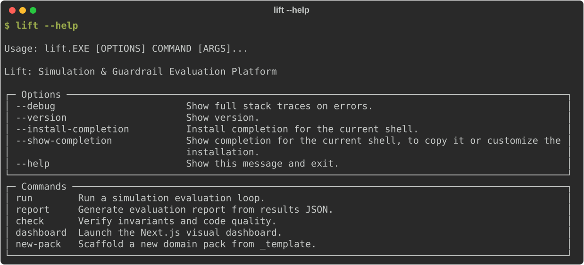
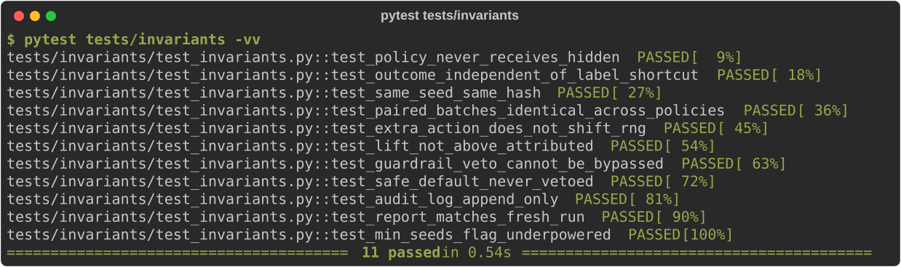
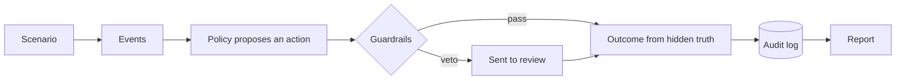

# Lift

**Don't trust AI decisions. Measure them.**

[](https://github.com/Subham503/Lift/actions/workflows/ci.yml)
[](LICENSE)
[](pyproject.toml)
[](#status)

[What works today](#what-works-today) ·
[Results](#results) ·
[Status](#status) ·
[Quickstart](#quickstart) ·
[How it works](#how-it-works) ·
[Contributing](#contributing)

</div>

---

Lift tests decision policies, with fraud flagging as the first example, against a do-nothing baseline on identical simulated events. It is built to report the measured difference with a confidence interval, the harm to good customers right next to it, and the limits of the result.

> [!WARNING]
> **Pre-alpha. There is no result to show yet.** The engine and its 11 invariant tests work. The first domain pack is still being built. Anything the dashboard shows today is labeled demo data.

## What works today

Both captures below are generated from real command output by `scripts/make_readme_assets.py`. Nothing is typed by hand.

**The CLI**



`lift report` renders a results file as a table with confidence intervals. `lift run`, the command that writes that file, is next. There is no screenshot of a result here because none exists yet, and none will be faked.

**The rules the engine enforces**



<details>
<summary>What each of the 11 invariant tests checks</summary>

| Test | Plain meaning |
|:--|:--|
| `policy_never_receives_hidden` | A policy gets observable state only. Passing it hidden truth raises an error. |
| `outcome_independent_of_label_shortcut` | The label text cannot change an outcome. Only fraud or not, and the amount, count. |
| `same_seed_same_hash` | The same seed gives byte-identical random streams. |
| `paired_batches_identical_across_policies` | Every policy sees the same events for a seed. A different seed gives different events. |
| `extra_action_does_not_shift_rng` | Acting on one event never changes the luck of the next one. |
| `lift_not_above_attributed` | Measured lift cannot exceed a benefit figure computed by a second, independent route. |
| `guardrail_veto_cannot_be_bypassed` | A veto changes the final action and is recorded. No override argument exists. |
| `safe_default_never_vetoed` | `ALLOW` and `GIVE_UP` pass through unchanged. The ignored veto is still recorded. |
| `audit_log_append_only` | Earlier bytes never change. There is no delete or update method. |
| `report_matches_fresh_run` | Same inputs give the same report, except the timestamp line. |
| `min_seeds_flag_underpowered` | Too few seeds get flagged as underpowered. |

</details>

## Results

**No results yet.**

When the first run exists, this section will show the headline lift with its confidence interval, the harm measured next to it, and the exact command that reproduces both. Every number carries one tag:

| Tag | Meaning |
|:--|:--|
| `REAL-DATA` | Measured on a real public dataset, by a command anyone can rerun |
| `SIMULATED` | Measured inside the Lift simulator |
| `ASSUMPTION` | An input we chose, such as the fraud rate or the cost of a review |

A number with no tag counts as a bug.

## What is real and what is simulated

| Part | Kind | Detail |
|:--|:--|:--|
| Engine, guardrails, audit log, bootstrap CI, report generator | Real code, tested | 11 invariants plus unit tests |
| Transaction stream | `SIMULATED` | Synthetic events, not calibrated to any real data |
| Fraud rate, chargeback fee, review cost, friction, review catch rate | `ASSUMPTION` | Chosen by us in `core/sim/costs.py` and `core/sim/scenarios.py`, listed in [`packs/payments_fraud/LIMITS.md`](packs/payments_fraud/LIMITS.md) |
| Real transaction data | None | Not used anywhere |

### Known limitations

- Every dollar value comes from an assumed cost model. Results hold only under it, and changing it can change which policy wins.
- The synthetic features overlap on purpose, but the overlap is not calibrated to real fraud.
- The payments fraud policies and `HighValueGuardrail` are still stubs.
- A simulated result is not evidence of a real deployment outcome.

## Status

✅ done · 🟡 next · ⬜ planned

| | Area | Notes |
|:-:|:--|:--|
| ✅ | Lint, type checks, CI workflow | Configured |
| ✅ | Frozen rule files with hash verification | Build fails if they change |
| ✅ | Claim guard for banned phrases and untagged figures | Unit tested |
| ✅ | RNG streams, bootstrap CI, audit log, guardrail chain, cost model, outcome resolution, report generator | Unit tested |
| ✅ | Evaluation harness and synthetic transaction scenario | |
| ✅ | 11 invariant tests | All passing |
| ✅ | `lift report` | Reads a results file |
| 🟡 | Payments fraud policies and `HighValueGuardrail` | Stubs |
| 🟡 | `lift run` and results files | Not implemented |
| 🟡 | Local dashboard | Interface built, demo data only |
| ⬜ | `lift check`, `lift dashboard`, `lift new-pack` | Print "not implemented" |
| ⬜ | Harm and fairness slices | |
| ⬜ | Held-out stress scenarios and sensitivity runs | |
| ⬜ | Second pack (logistics) | |

## Quickstart

Requires Python 3.12 or newer.

**Windows (PowerShell)**

```powershell
git clone https://github.com/Subham503/Lift.git
cd Lift
python -m venv .venv
.\.venv\Scripts\Activate.ps1
pip install -e ".[dev]"
```

**Linux or macOS**

```bash
git clone https://github.com/Subham503/Lift.git
cd Lift
python -m venv .venv
source .venv/bin/activate
pip install -e ".[dev]"
```

**Check that it works**

```bash
lift --help
pytest
python scripts/dev.py check
```

`python scripts/dev.py check` runs six stages: lint, types, claim guard, unit tests, the 11 invariant tests, and frozen-file hashes.

## How it works



- Policies see only observable state. Ground truth stays hidden from them.
- Every policy runs on identical event batches with fixed seeds.
- Planned comparison set: do-nothing baseline, tuned rules, a learned model, and an oracle used only as a ceiling.
- Benefit is always shown next to harm: wrongly blocked customers, friction, review load, and the worst-off group.

## Design rules

The project is built under written rules that the code and tests must follow.

| File | What it covers |
|:--|:--|
| [`core/RULES.md`](core/RULES.md) | Engine invariants, each backed by a test |
| [`docs/HONESTY.md`](docs/HONESTY.md) | Tagging, harm reporting, banned claims, limits files |
| [`AGENTS.md`](AGENTS.md) | How contributors and coding agents work, phase by phase |

These three files are frozen. A hash check fails the build if they change.

<details>
<summary>Repository layout</summary>

```
core/        engine: sim, policies, guardrails, eval, audit, report, cli
packs/       domain packs, plus a template for new ones
dashboard/   local results viewer (reads result files only)
docs/        honesty rules, architecture, phase plans, README captures
reports/     phase reports and generated evaluation reports
tests/       invariants, unit, integration
scripts/     dev runner, claim guard, README capture generator
```

</details>

## Contributing

The engine is still moving. Read [`CONTRIBUTING.md`](CONTRIBUTING.md) and the design rules above first. Packs, policies, and scenarios are the planned contribution points once the core settles.

## License

Distributed under the [MIT License](LICENSE).